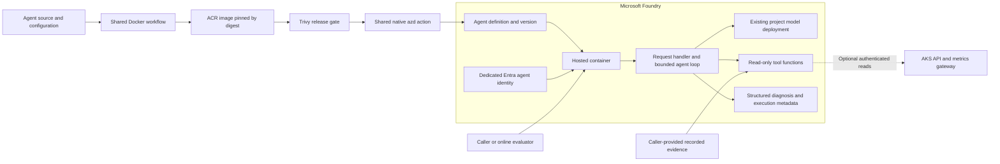
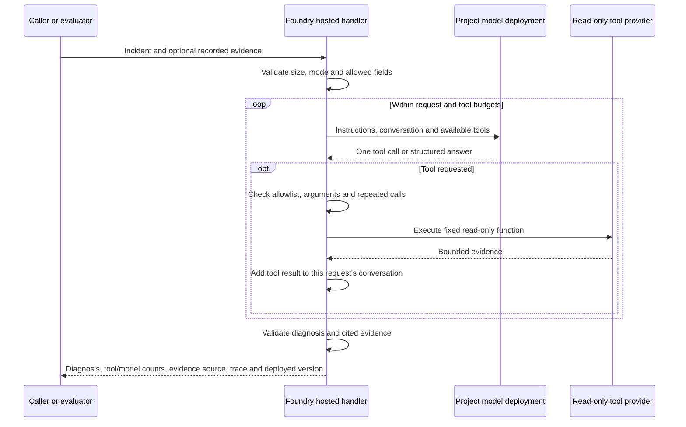

# Foundry agent template

A complete, inspectable agent hosted in **Microsoft Foundry**. SRE is the first
case study: its instructions, tools and evaluation data can change without
changing the bounded model/tool loop. AKS is only an optional investigation target.

The implementation is kept together in one review PR before extracting reusable
pieces. The existing shared Docker workflow and native Foundry deployment action
are already in use by the caller; this candidate adds their first actual agent.
Local tests do not establish a successful hosted deployment or live AKS access.

## Where each component lives

```text
agents/sre/
├── azure.yaml              Foundry deployment definition
├── Dockerfile              Container build and startup
├── requirements.txt        Pinned direct/transitive dependencies and hashes
├── config/
│   └── agent.yaml          Instructions, model, budgets and response schema
├── runtime/
│   └── agent.py            Model client and bounded execution loop
├── hosting/
│   └── server.py           Foundry HTTP adapter and composition
├── tools/
│   └── diagnostics.py      SRE evidence collectors and decision checks
├── evaluation/
│   ├── run.py              Model and hosted evaluation commands
│   └── cases/              Recorded evidence and independent grading rubrics
└── tests/
    └── test_agent.py       Offline contract and integration tests
```



| Component | Definition / implementation | What Foundry does |
| --- | --- | --- |
| Project and model deployment | Existing bootstrap infrastructure; model alias `chat` | Hosts the project API and underlying model deployment. This PR creates neither. |
| Agent definition/version | [azure.yaml](agents/sre/azure.yaml) | Registers the image, protocol, runtime environment and endpoint. No custom compute sizing is specified here. |
| Runtime identity | Platform-created Entra agent identity | Gives the running agent its own identity; the GitHub publisher identity is separate. Extra external access requires explicit grants. |
| HTTP protocol and health | [hosting/server.py](agents/sre/hosting/server.py), official Invocations adapter | Routes the public authenticated endpoint to port 8088; the adapter supplies `/readiness`, shutdown and tracing integration. |
| Behaviour and model selection | [config/agent.yaml](agents/sre/config/agent.yaml), `MODEL_DEPLOYMENT_NAME` | Instructions and tool definitions are **inside the container**, sent with model requests; they are not separate portal prompt-agent resources. |
| Model injection/authentication | [runtime/agent.py](agents/sre/runtime/agent.py), `model_client` | Injects `FOUNDRY_PROJECT_ENDPOINT`; Azure Identity obtains short-lived tokens for the project model API. |
| Agent loop and working state | [runtime/agent.py](agents/sre/runtime/agent.py), `run` | Executes in the hosted container. Conversation/evidence are request-local; no database, durable memory or cross-request history is configured. |
| SRE tools and decision checks | [tools/diagnostics.py](agents/sre/tools/diagnostics.py) | Executes these Python functions in the container, not as managed Foundry toolbox resources. |
| Image and dependencies | [Dockerfile](agents/sre/Dockerfile), [requirements.txt](agents/sre/requirements.txt) | Pulls the immutable amd64 image from ACR. Runtime contains the application and its locked Python dependencies. |
| Evaluation | [evaluation/run.py](agents/sre/evaluation/run.py), [cases](agents/sre/evaluation/cases), [tests](agents/sre/tests/test_agent.py) | Online evaluation invokes the hosted endpoint; offline contract tests need no Azure access. |

`azure.yaml` describes hosting. `config/agent.yaml` describes behaviour. `runtime/agent.py`
provides execution. Keeping those responsibilities visible is the template's
main purpose; adding a framework, plugin registry or custom deployment manifest
would obscure this first review.

## Follow one request



The investigation loop runs in the Foundry-hosted container. The model can request only declared functions,
with no arbitrary namespace, URL, shell command or tool arguments. Each tool can
run once per investigation; request, time, output-token and evidence budgets bound
work. Two investigations can run concurrently per container; additional requests
wait. This is a small concurrency bound, not a measured autoscaling configuration.

The SRE check requires workload and event evidence plus degraded readiness before
accepting `actionable`. It does not establish that a proposed diagnosis is correct.
The returned decision never triggers a deployment, patch or draft PR.

## Run and evaluate

From `agents/sre`:

```sh
python3 -m venv .venv
.venv/bin/pip install --require-hashes --only-binary=:all: -r requirements.txt
.venv/bin/python -m unittest discover -s tests -v
```

| Mode | What is real | What is recorded / simulated |
| --- | --- | --- |
| Unit/HTTP contract tests | Runtime, HTTP adapter, validation and collectors' request contracts | Model responses and external HTTP responses; no Azure or telemetry export |
| `python -m evaluation.run --mode model` | Authenticated model inference | Dataset evidence; no hosted container and no AKS reads |
| `python -m evaluation.run --mode hosted` | Foundry endpoint, hosted runtime, identity and model inference | Dataset evidence; no AKS reads |
| `python -m evaluation.run --mode hosted --live` | Hosted runtime plus configured external collectors | No fixture evidence is sent; case expectations still need human comparison to current conditions |

The historical healthy and readiness-fault cases came from the archive. Grader
reference, rubric and provenance remain in the evaluator; the model receives only
incident text and evidence that it requests. Build tests never call a paid model.
A dataset replay is an offline *evaluation dataset*, not an offline model: model
and hosted modes perform real Azure calls and incur usage.

For a model-only case replay, authenticate through a supported Azure Identity
credential (local Azure CLI is one option) and supply the current project endpoint:

```sh
export FOUNDRY_PROJECT_ENDPOINT='https://<account>.services.ai.azure.com/api/projects/<project>'
.venv/bin/python -m evaluation.run evaluation/cases/readiness-fault.yaml --mode model
```

After deployment, inspect the agent with native `azd ai agent show`. Use its exact
Invocations endpoint and record the returned deployed agent/version in the report:

```sh
.venv/bin/python -m evaluation.run evaluation/cases/readiness-fault.yaml \
  --mode hosted --endpoint "$INVOCATIONS_ENDPOINT"
```

Automatic checks cover contracts, budgets and selected forbidden claims. A result
remains `human_review_required`, with the case rubric included for platform-engineer
assessment. Passing unit tests or these checks does not demonstrate diagnosis
quality, prompt-injection resistance or a verified recovery. For live evaluation,
use an incident/case whose namespace and expectations match the actual target;
the bundled snapshots do not assert the platform's current condition.

## Connect AKS as an external subject

The default `DIAGNOSTICS_BACKEND: provided` accepts explicitly labelled,
caller-provided evidence. With no evidence, no tools are advertised and the agent
must abstain. It does not silently fall back to live access.

To use live collectors, set these agent environment values in `azure.yaml`:

```yaml
DIAGNOSTICS_BACKEND: kubernetes
KUBE_API_URL: https://<approved-api-host>
KUBE_ALLOWED_NAMESPACE: <approved-namespace>
# KUBE_CA_FILE: /app/<trusted-ca-file> # Only for a separately supplied private CA.
```

The hosted agent's identity needs explicit read-only authorization for Deployments,
Rollouts, Pods, events and Pod logs in that namespace. It also needs network access
to the API. The implementation uses Azure Identity tokens for the AKS server
application, TLS verification and fixed GET requests. The configured namespace
bounds which incidents the live collectors accept.
No such role, binding, network exception or CA delivery is created in this PR.
If packaging a trusted public CA, explicitly allow that file in `.dockerignore`;
private keys and local environment files remain excluded.

Metrics are optional. `METRICS_URL` must identify an HTTPS Prometheus-compatible
gateway that accepts Entra tokens for `METRICS_TOKEN_SCOPE`. If absent,
`service_metrics` is not exposed. The archive's in-cluster Mimir address is not
reused. Browser SSO alone does not prove machine-to-machine access to that gateway.
These integrations need live authorization/connectivity verification before a
live-tool evaluation can be claimed. A live backend rejects caller-provided evidence.

## Build and delivery

```sh
docker build --platform linux/amd64 -t foundry-agent-review agents/sre
```

The Docker build runs the same offline tests before producing the non-root runtime.
The base is official Python 3.12 on Alpine 3.24, with a pinned upstream Kerberos
security update. Compared with the reviewed Debian variants, it avoids their
remaining HIGH/CRITICAL findings without another registry login. Alpine uses
musl rather than glibc: binary-wheel installation, SDK/HTTP tests and amd64 image
checks cover that compatibility boundary; hosted inference remains a live gate.
Its digest-pinned Python base and hashed dependencies are reproducible inputs;
security updates require updating the package/base pins and rebuilding.
`requirements.txt` is the single dependency list: direct and transitive packages
are pinned and hashed together. When updating a version, resolve compatible pins
and regenerate hashes into a temporary file before replacing this list. There is
no second dependency declaration to synchronise. Builds require binary wheels so
package installation does not introduce unpinned source-build dependencies.

[deploy-agents.yml](.github/workflows/deploy-agents.yml) discovers `agents/*/`
and calls the existing scalar shared Docker workflow for each agent. PR builds
run tests and scan the local image without publishing or Azure login. Main
publication pushes to ACR, scans by digest, then releases a per-agent image record. HIGH/CRITICAL findings block
Foundry deployment; a rejected image can remain in ACR because push precedes scan.

The deploy matrix verifies the record's repository, source revision, image path
and digest, checks current main freshness, then calls the shared native Foundry
action with that digest. It never uses a last-writer matrix output as a digest
map. Per-agent concurrency serializes this workflow's deployments; it is not a
cloud-wide deployment lock. Source and dependency tests stay in the agent build.

Bootstrap now refreshes organization variables `FOUNDRY_PROJECT_ENDPOINT` and
`AZURE_LOCATION`; no per-repository copy is needed. Repository/environment values
can shadow them. GitHub Free exposes organization variables to public consumers.
The existing organization secrets `AZURE_CLIENT_ID`, `AZURE_TENANT_ID` and
`AZURE_SUBSCRIPTION_ID` authenticate CI through OIDC. Foundry creates a separate
runtime agent identity. Effective CI authentication, ACR pull and model access
remain real deployment acceptance checks, not consequences of secret presence.

The shared action reuses installed compatible `azd`, installs it only if missing,
then deploys through the native extension. `HOSTED_AGENT_IMAGE` is the verified
prebuilt digest; `AZD_AGENT_SKIP_ACR=true` and `docker.remoteBuild: true` select
that image without a second build. `FOUNDRY_PROJECT_ENDPOINT` is referenced by the
existing project service; it is not redefined in the container environment because
Foundry injects that reserved value. The endpoint requires Entra authorization.

Foundry versions a container definition, not each Python function separately.
There are no managed connections, routines, skills, memory stores or toolboxes in
this template. SDK operational spans cover investigations/model/tool calls;
message-content capture is explicitly disabled. Trace export still depends on
the hosting environment's telemetry configuration and has not been live-verified.
Logs and redaction remain sensitive; common credential masking is not a DLP guarantee.

**Follow-up:** review the efficiency of `.github/workflows/deploy-agents.yml`,
including matrix/job overhead and per-agent artifact handoff. Do not change that
composition during this component review. Signing, automated smoke gating,
promotion/rollback, route pinning and deletion remain separate delivery work.
Native deployment can move an unpinned endpoint to the latest version; pin a
serving route before deploying a candidate. Removing a directory does not delete
its hosted agent.

## What changes for another agent

Keep the hosting/runtime boundaries; replace the example instructions, tool
functions and case-specific result validation, then supply independent evaluation
cases. A new agent directory must use its directory name as the `azure.yaml`
service key, preserve `${AZURE_ENV_NAME}` for repository/agent identity, and provide
its own Dockerfile and locked dependencies. The existing workflow discovers it.
This PR deliberately keeps the pieces visible together; it does not claim the
runtime has already been extracted into a centrally consumed library.

The archive is a source reference, not a runtime dependency. `runtime/agent.py` adapts
its `model.py` and bounded replay loop; `tools/diagnostics.py` adapts `diagnostics.py` and the
triage guard; `hosting/server.py` retains the official adapter approach. Cases retain
source provenance. The archive remains available for the original implementation history.

Sources: [archived source map](https://github.com/sre-agent-foundry),
[Microsoft runtime contract](https://learn.microsoft.com/en-us/azure/foundry/agents/concepts/hosted-agent-contract),
[native azure.yaml](https://learn.microsoft.com/en-us/azure/foundry/agents/concepts/azure-yaml-reference),
[deployment and identity](https://learn.microsoft.com/en-us/azure/foundry/agents/how-to/deploy-hosted-agent),
[protocol adapter](https://learn.microsoft.com/en-us/azure/foundry/agents/how-to/add-protocol-adapter).
