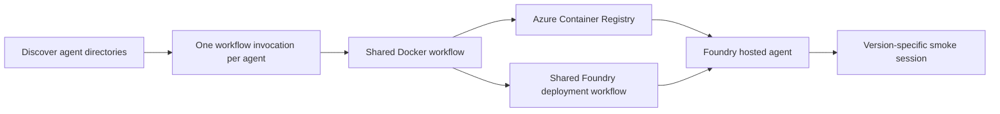

# Agent catalog

Agent source and minimal deployment intent for Microsoft Foundry hosted agents.
GitHub Actions builds containers in ACR and deploys them directly to Foundry.
The delivery path has no dependency on AKS, Helm or Argo.

The catalog is currently empty. These workflows do not restore the retired SRE
runtime, diagnostic broker or coding workers. Their historical source remains in
[sre-agent-foundry/agent-catalog](https://github.com/sre-agent-foundry/agent-catalog).

## Add an agent

Add a directory under `agents/` with a unique lowercase name (letters, digits and
hyphens, up to 63 characters). Each directory contains:

```text
agents/<name>/
  Dockerfile
  deployment.json
  smoke.json
  ...agent source and dependencies...
```

No workflow or shared-repository edit is needed for another agent. Discovery is
inline in `deploy-agents.yml`; an empty catalog skips the matrix. Malformed agent
directories fail discovery rather than silently being skipped. The Docker build
context is the agent directory and its image must implement the selected Foundry
protocol on port 8088 using a supported hosting library.

Minimal `deployment.json`:

```json
{"model_deployment": "chat"}
```

The shared deployment workflow defaults to one CPU, 2Gi memory and Invocations
protocol 2.0.0. Optional fields are `protocol` (`invocations` or `responses`),
`cpu`, `memory` and string-valued `environment_variables`. The workflow injects
`MODEL_DEPLOYMENT_NAME`, `FOUNDRY_PROJECT_ENDPOINT` and `PYTHONNOUSERSITE=1`.
Keep credentials out of these files and the image; use Entra identity and Foundry
project connections for required secret references.

`smoke.json` supplies a small request and nonempty expected response fields:

```json
{"request": {"message": "health"}, "expect": {"status": "ok"}}
```

Choose expectations your agent actually implements. Nested expected objects are
matched as subsets; arrays and scalar values must match exactly. Responses agents
also need `status: completed`; their request usually contains `input`. Smoke
responses are checked without being printed to workflow logs.

## Delivery and release boundaries



PRs build without publishing and validate deployment/smoke configuration without
Azure login. Current main pushes and manual main runs publish and deploy. Each
agent's thin workflow passes its own Docker image, digest and source revision to
deployment; matrix outputs are not combined into a single shared digest. Up to
four agents run in parallel, while each agent's lifecycle is serialized. Both
shared templates remain flat, handling one image or agent per call; discovery,
iteration, dependencies and concurrency belong to this repository. A stale
main revision fails before Azure login.

Image repositories derive from this repository and agent directory. Foundry names
derive from the agent name plus a stable hash of owner/repository and agent, so
another repository or agent does not reuse the same identity. Retries reuse the
exact source/image/configuration version; conflicting artifacts for one revision
fail. Unchanged agents can reuse cached image layers, but a new source revision
creates a new Foundry version even if its image digest is unchanged.

The first successfully tested version is pinned as the serving version. Later
deployments require a pinned serving route, test the candidate in its own session
and leave ordinary traffic unchanged. Smoke sessions are stopped in cleanup;
session-record retention is managed by Foundry. Promotion, rollback and agent
deletion remain explicit operator operations, outside these workflows. Removing a
directory does not delete its deployed agent. Coordinate other API writers: GitHub
concurrency does not serialize portal or external deployments, and route readback
is not an atomic compare-and-swap.

## Repository configuration and acceptance

Set the repository variable `FOUNDRY_PROJECT_ENDPOINT` to the operator-provided
project URL, for example
`https://<account>.services.ai.azure.com/api/projects/<project>`. Shared workflows
are pinned to immutable commits; merge [ops-shared PR13](https://github.com/ai-platform-portfolio/ops-shared/pull/13) before this caller.

The existing organization secrets `AZURE_CLIENT_ID`, `AZURE_TENANT_ID` and
`AZURE_SUBSCRIPTION_ID` supply native Azure OIDC login. Their referenced identity
needs GitHub federation, ACR push access and Foundry deployment permissions. The
current platform reuses `kubernetes-spn`; the publisher does not create identities
or grant Azure roles. Foundry's image-pull identity separately needs access to ACR.
The previously retired image-pull grant has not been restored by these PRs.

With no agents, CI can prove discovery and a safe skipped matrix, not OIDC login,
image pulling, model access or hosted execution. Those remain live acceptance gates
when the first agent is added. No network, registry or role assignment changes are
performed by these workflows.

References: [Foundry deployment](https://learn.microsoft.com/en-us/azure/foundry/agents/how-to/deploy-hosted-agent),
[release isolation](https://learn.microsoft.com/en-us/azure/foundry/agents/how-to/manage-hosted-agent),
[GitHub matrix workflows](https://docs.github.com/en/actions/how-tos/reuse-automations/reuse-workflows).
