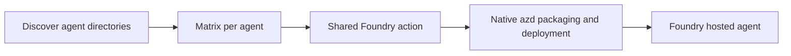

# Agent catalog

Agent source and native Microsoft Foundry deployment configuration. One GitHub
workflow discovers agent projects and calls the shared Foundry action for each.
Azure Developer CLI (`azd`) owns packaging, building and deployment; this path has
no separate Docker workflow, custom publisher, Helm, Argo or AKS dependency.

The catalog is currently empty. The retired SRE runtime, diagnostic broker and
coding workers remain archived in
[sre-agent-foundry/agent-catalog](https://github.com/sre-agent-foundry/agent-catalog).

## Add an agent

Add `agents/<name>/azure.yaml` alongside the agent source and dependency files.
Names use lowercase letters, digits and hyphens; repository name plus agent name
must fit 63 characters. Use the directory name as the native agent service key.
New directories are discovered automatically; no workflow edit is needed.

For example, a `researcher` source-code project could declare:

```yaml
name: researcher

services:
  foundry:
    host: azure.ai.project
    endpoint: ${FOUNDRY_PROJECT_ENDPOINT}

  researcher:
    host: azure.ai.agent
    uses: [foundry]
    kind: hosted
    name: ${AZURE_ENV_NAME}
    project: .
    codeConfiguration:
      runtime: python_3_13
      entryPoint: main.py
      dependencyResolution: remote_build
    protocols:
      - protocol: responses
        version: 2.0.0
    env:
      PYTHONNOUSERSITE: "1"
```

Your source must implement the selected Foundry protocol. Configure its model,
resources and tools through native `azure.yaml` and application code. For container
packaging, use native Docker configuration and a Dockerfile instead of
`codeConfiguration`; a prebuilt digest-pinned `image` is also supported. No custom
`deployment.json` or `smoke.json` contract is required by this workflow.

## Delivery



PRs run discovery and the issue check without Azure login or deployment. Current
main pushes and manual main runs deploy up to four agents concurrently. Each
agent is serialized, checked out at the exact run revision, and checked against
current main before the action. An empty catalog skips the matrix.

The action is pinned to merged ops-shared PR14. It reuses an installed `azd` or
installs it when missing, ensures the Foundry agent extension, uses GitHub OIDC,
and prepares local azd context. Environment names derive from repository and
agent; use `${AZURE_ENV_NAME}` for the native hosted-agent name to preserve that
isolation. `.azure/` directories are ignored, including those under agent projects.

Set repository variables `FOUNDRY_PROJECT_ENDPOINT` and `AZURE_LOCATION` to the
operator-provided existing project endpoint and Azure region. The existing
organization secrets `AZURE_CLIENT_ID`, `AZURE_TENANT_ID` and
`AZURE_SUBSCRIPTION_ID` provide the federated identity contract. The current platform
reuses `kubernetes-spn`; effective CI login and deployment still need live proof.
Keep credentials and private configuration out of source and images.

This workflow invokes deployment, not infrastructure provisioning. Native azd can
configure agent identity/RBAC and applies endpoint settings from `azure.yaml`;
its required permissions and image-pull access must be available. Pin the serving
version before deploying a candidate and promote explicitly. Application smoke
tests, evaluation, promotion, rollback and deletion are not automated here.
Removing a directory does not delete its hosted agent. Coordinate external writers;
GitHub concurrency is not a cloud-wide deployment lock.

With no agents, validation proves discovery and safe skipping only. Native package
compatibility, identity mapping, image/model access and hosted execution remain
first-agent acceptance gates; this PR does not deploy an agent or restore the
retired image-pull role.

References: [Microsoft CI/CD guidance](https://learn.microsoft.com/en-us/azure/foundry/agents/how-to/set-up-ci-cd-cli),
[native configuration](https://learn.microsoft.com/en-us/azure/foundry/agents/concepts/azure-yaml-reference),
[Foundry lifecycle](https://learn.microsoft.com/en-us/azure/foundry/agents/how-to/manage-hosted-agent).
