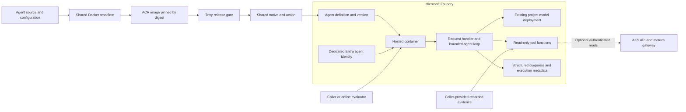
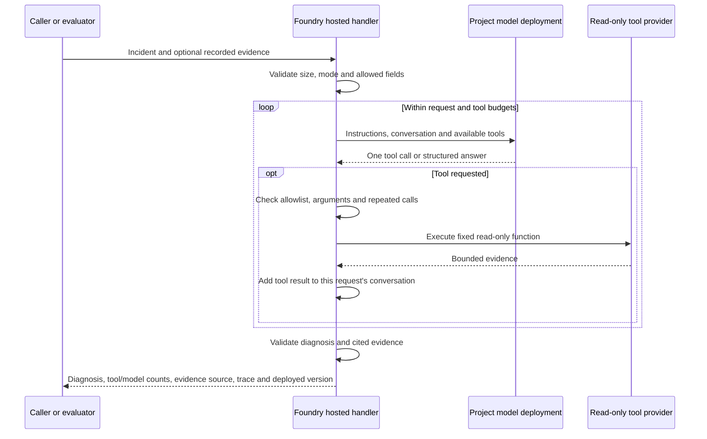
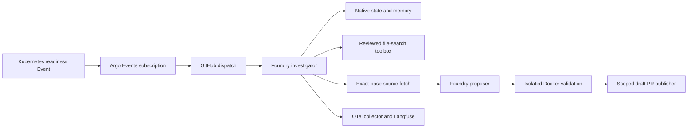

# Foundry agent template

A complete, inspectable agent hosted in **Microsoft Foundry**. SRE is the first
case study: its instructions, tools and evaluation data can change without
changing the bounded model/tool loop. AKS hosts optional shared observability
packages and can separately be an optional investigation target.

The implementation is kept together in one review PR before extracting reusable
pieces. The existing shared Docker workflow and native Foundry deployment action
are already in use by the caller; this candidate adds their first actual agent.
Local tests do not establish a successful hosted deployment or live AKS access.

## Where each component lives

```text
agents/sre/
├── azure.yaml              Foundry deployment definition
├── image/
│   ├── Dockerfile          Container build and startup
│   └── requirements.txt    Pinned direct/transitive dependencies and hashes
├── config/
│   └── agent.yaml          Instructions, model, budgets and response schema
├── runtime/
│   └── agent.py            Model client and bounded execution loop
├── hosting/
│   └── server.py           Foundry HTTP adapter and composition
├── telemetry/
│   └── tracing.py          Caller settings for the shared observability package
├── tools/
│   └── diagnostics.py      SRE evidence collectors and decision checks
├── evaluation/
│   ├── run.py              Model and hosted evaluation commands
│   ├── release.py          Validated version promotion/rollback policy
│   └── cases/              Recorded evidence and independent grading rubrics
└── tests/
    ├── test_agent.py       Runtime contract and integration tests
    └── test_release.py     Telemetry and release acceptance boundaries
```



| Component | Definition / implementation | What Foundry does |
| --- | --- | --- |
| Project and model deployment | Existing bootstrap infrastructure; model alias `chat` | Hosts the project API and underlying model deployment. This PR creates neither. |
| Agent definition/version | [azure.yaml](agents/sre/azure.yaml) | Registers the image, protocol, runtime environment and endpoint. No custom compute sizing is specified here. |
| Runtime identity | Platform-created Entra agent identity | Gives the running agent its own identity; the GitHub publisher identity is separate. Extra external access requires explicit grants. |
| HTTP protocol and health | [hosting/server.py](agents/sre/hosting/server.py), official Invocations adapter | Routes the public authenticated endpoint to port 8088; the adapter supplies `/readiness`, shutdown and tracing integration. |
| Behaviour and model selection | [config/agent.yaml](agents/sre/config/agent.yaml), `MODEL_DEPLOYMENT_NAME` | Instructions and tool definitions are **inside the container**, sent with model requests; they are not separate portal prompt-agent resources. |
| Model injection/authentication | [runtime/agent.py](agents/sre/runtime/agent.py), `model_client` | Injects `FOUNDRY_PROJECT_ENDPOINT`; Azure Identity obtains short-lived tokens for the project model API. |
| Agent loop and working state | [runtime/agent.py](agents/sre/runtime/agent.py), `run` | The shared runtime executes in the hosted container. Conversation/evidence are request-local; authenticated live invocations also use native memory, historical knowledge and bounded checkpoints. Recorded evaluations bypass those stores. |
| SRE tools and decision checks | [tools/diagnostics.py](agents/sre/tools/diagnostics.py) | Executes these Python functions in the container, not as managed Foundry toolbox resources. |
| Image and dependencies | [image/Dockerfile](agents/sre/image/Dockerfile), [image/requirements.txt](agents/sre/image/requirements.txt) | Pulls the immutable amd64 image from ACR. Runtime contains the application and its locked Python dependencies. |
| Evaluation | [evaluation/run.py](agents/sre/evaluation/run.py), [cases](agents/sre/evaluation/cases), [tests](agents/sre/tests/test_agent.py) | Online evaluation invokes the hosted endpoint; offline contract tests need no Azure access. |
| Observability | [telemetry/tracing.py](agents/sre/telemetry/tracing.py) | Creates a trace per investigation with model/tool children. Optional OTLP export reaches the shared collector; the collector forwards marked traces to Langfuse and Tempo. |

`azure.yaml` describes hosting. `config/agent.yaml` describes behaviour. `runtime/agent.py`
provides execution. Keeping those responsibilities visible is the template's
main purpose; adding a framework, plugin registry or custom deployment manifest
would obscure this first review.

## Follow one request



The investigation loop runs in the Foundry-hosted container. The model can request only declared functions,
with no arbitrary namespace, URL, shell command or tool arguments. Each tool can
run once per investigation; request, time, output-token and evidence budgets bound
work. Two investigations can run concurrently per container; additional requests
wait. This is a small concurrency bound, not a measured autoscaling configuration.

The SRE check requires workload and event evidence plus degraded readiness before
accepting `actionable`. It does not establish that a proposed diagnosis is correct.
An ordinary investigation response publishes no changes. The separate event
workflow can pass an actionable live diagnosis into proposal, isolated validation
and draft publication under the trusted coding policy. It never merges or deploys.

## Run and evaluate

From `agents/sre`:

```sh
python3 -m venv .venv
.venv/bin/pip install --require-hashes --only-binary=:all: -r image/requirements.txt
.venv/bin/python -m unittest discover -s tests -v
```

| Mode | What is real | What is recorded / simulated |
| --- | --- | --- |
| Unit/HTTP contract tests | Runtime, HTTP adapter, validation and collectors' request contracts | Model responses and external HTTP responses; no Azure or telemetry export |
| `python -m evaluation.run --mode model` | Authenticated model inference | Dataset evidence; no hosted container and no AKS reads |
| `python -m evaluation.run --mode hosted` | Foundry endpoint, hosted runtime, identity and model inference | Dataset evidence; no AKS reads |
| `python -m evaluation.run --mode hosted --live` | Hosted runtime plus configured external collectors | No fixture evidence is sent; case expectations still need human comparison to current conditions |

The historical healthy and readiness-fault cases came from the archive. Grader
reference, rubric and provenance remain in the evaluator; the model receives only
incident text and evidence that it requests. Build tests never call a paid model.
A dataset replay is an offline *evaluation dataset*, not an offline model: model
and hosted modes perform real Azure calls and incur usage.

For a model-only case replay, authenticate through a supported Azure Identity
credential (local Azure CLI is one option) and supply the current project endpoint:

```sh
export FOUNDRY_PROJECT_ENDPOINT='https://<account>.services.ai.azure.com/api/projects/<project>'
.venv/bin/python -m evaluation.run evaluation/cases/readiness-fault.yaml --mode model
```

After deployment, inspect the agent with native `azd ai agent show`. Use its exact
Invocations endpoint and record the returned deployed agent/version in the report:

```sh
.venv/bin/python -m evaluation.run evaluation/cases/readiness-fault.yaml \
  --mode hosted --endpoint "$INVOCATIONS_ENDPOINT"
```

Automatic checks cover contracts, budgets and selected forbidden claims. A result
remains `human_review_required`, with the case rubric included for platform-engineer
assessment. Passing unit tests or these checks does not demonstrate diagnosis
quality, prompt-injection resistance or a verified recovery. For live evaluation,
use an incident/case whose namespace and expectations match the actual target;
the bundled snapshots do not assert the platform's current condition.

## Connect AKS as an external subject

The default `DIAGNOSTICS_BACKEND: provided` accepts explicitly labelled,
caller-provided evidence. With no evidence, no tools are advertised and the agent
must abstain. It does not silently fall back to live access.

To use live collectors, set these agent environment values in `azure.yaml`:

```yaml
DIAGNOSTICS_BACKEND: kubernetes
KUBE_API_URL: https://<approved-api-host>
KUBE_ALLOWED_NAMESPACE: <approved-namespace>
# KUBE_CA_FILE: /app/<trusted-ca-file> # Only for a separately supplied private CA.
```

The hosted agent's identity needs explicit read-only authorization for Deployments,
Rollouts, Pods, events and Pod logs in that namespace. It also needs network access
to the API. The implementation uses Azure Identity tokens for the AKS server
application, TLS verification and fixed GET requests. The configured namespace
bounds which incidents the live collectors accept.
No such role, binding, network exception or CA delivery is created in this PR.
If packaging a trusted public CA, explicitly allow that file in `.dockerignore`;
private keys and local environment files remain excluded.

Metrics are optional. `METRICS_URL` must identify an HTTPS Prometheus-compatible
gateway that accepts Entra tokens for `METRICS_TOKEN_SCOPE`. If absent,
`service_metrics` is not exposed. The archive's in-cluster Mimir address is not
reused. Browser SSO alone does not prove machine-to-machine access to that gateway.
These integrations need live authorization/connectivity verification before a
live-tool evaluation can be claimed. A live backend rejects caller-provided evidence.

## Build and delivery

```sh
docker build --platform linux/amd64 -f agents/sre/image/Dockerfile \
  -t foundry-agent-review agents/sre
```

The build context remains `agents/sre/`; `.dockerignore` stays at that root.
Both the workflow and native `azure.yaml` reference `image/Dockerfile`.

The Docker build runs the same offline tests before producing the non-root runtime.
The base is official Python 3.12 on Alpine 3.24, with a pinned upstream Kerberos
security update. Compared with the reviewed Debian variants, it avoids their
remaining HIGH/CRITICAL findings without another registry login. Alpine uses
musl rather than glibc: binary-wheel installation, SDK/HTTP tests and amd64 image
checks cover that compatibility boundary; hosted inference remains a live gate.
Its digest-pinned Python base and hashed dependencies are reproducible inputs;
security updates require updating the package/base pins and rebuilding.
`image/requirements.txt` is the single dependency list: direct and transitive packages
are pinned and hashed together. When updating a version, resolve compatible pins
and regenerate hashes into a temporary file before replacing this list. There is
no second dependency declaration to synchronise. Builds require binary wheels so
package installation does not introduce unpinned source-build dependencies.

[deploy-agents.yml](.github/workflows/deploy-agents.yml) discovers `agents/*/`
and calls the existing scalar shared Docker workflow for each agent. PR builds
run tests and scan the local image without publishing or Azure login. Main
publication pushes to ACR, scans by digest, then releases a per-agent image record. HIGH/CRITICAL findings block
Foundry deployment; a rejected image can remain in ACR because push precedes scan.

The deploy matrix verifies the record's repository, source revision, image path
and digest, checks current main freshness, then calls the shared native Foundry
action with that digest. It never uses a last-writer matrix output as a digest
map. Per-agent concurrency serializes this workflow's deployments; it is not a
cloud-wide deployment lock. Source and dependency tests stay in the agent build.

Bootstrap now refreshes organization variables `FOUNDRY_PROJECT_ENDPOINT` and
`AZURE_LOCATION`; no per-repository copy is needed. Repository/environment values
can shadow them. GitHub Free exposes organization variables to public consumers.
The existing organization secrets `AZURE_CLIENT_ID`, `AZURE_TENANT_ID` and
`AZURE_SUBSCRIPTION_ID` authenticate CI through OIDC. Foundry creates a separate
runtime agent identity. Effective CI authentication, ACR pull and model access
remain real deployment acceptance checks, not consequences of secret presence.

The shared action reuses installed compatible `azd`, installs it only if missing,
then deploys through the native extension. `HOSTED_AGENT_IMAGE` is the verified
prebuilt digest; `AZD_AGENT_SKIP_ACR=true` and `docker.remoteBuild: true` select
that image without a second build. `FOUNDRY_PROJECT_ENDPOINT` is referenced by the
existing project service; it is not redefined in the container environment because
Foundry injects that reserved value. The endpoint requires Entra authorization.

Foundry versions a container definition, not each Python function separately.
The native predeploy hook configures the memory store and publishes reviewed
knowledge into a revision-specific file-search toolbox. Operational spans cover investigations/model/tool calls;
message-content capture is explicitly disabled. Export has not been live-verified.
Logs and redaction remain sensitive; common credential masking is not a DLP guarantee.

**Follow-up:** review the efficiency of `.github/workflows/deploy-agents.yml`,
including matrix/job overhead and per-agent artifact handoff. Do not change that
composition without a concrete simplification. Signing and ordered deletion remain
separate delivery work. Removing a directory does not delete its hosted agent.

## Telemetry and evaluation traceability

The optional **repository** variable `AGENT_TRACES_ENDPOINT` supplies the exact
HTTPS OTLP traces URL, normally `https://otel.internal.<platform-domain>/v1/traces`.
Leave it unset to disable collector export. This is not an organization-level AKS
dependency. Standard `OTEL_SERVICE_NAME` can override the default service name.
The versioned `portfolio-agent-observability` wheel from application-library owns
provider setup, bounded export and shutdown. This agent supplies only service
identity and the Langfuse choice in `telemetry/tracing.py`; operation spans stay
with their code. The agent and model-only evaluation each initialize one provider; the host
uses its supported observability callback rather than configuring a second one.
Batch export has a bounded512-span queue, two-second HTTP timeout and bounded
flush. Collector outages can drop spans; they do not gate startup or inference.
No incident/prompt/tool payloads are added to spans or automatically instrumented.

Resource marker `langfuse.export="true"` keeps all child spans in the collector's
Langfuse pipeline. Agent, generation, tool and evaluator observations carry their
explicit types; generation spans include reported model/token counts without
message content. Langfuse credentials remain in the collector. Private ingress
uses the existing Foundry VNet injection/peering and an AKS internal load balancer
behind Envoy HTTPS. GitOps owns this shared package and its certificate automation.
TLS and subnet restrictions provide network trust, not per-agent authentication.

Evaluation reports include case ID/version, evaluation/runtime trace IDs, model,
evidence mode, agent/version, source commit and image digest. Model-only evaluation
can export when run from a connected network; GitHub-hosted CI retains reports
and hosted trace IDs without trying to reach the private collector. Automated
rubrics check contracts; diagnosis quality still requires the human rubric.

## Candidate acceptance, promotion and rollback

The existing workflow builds/scans/pushes an immutable image, preserves the
existing fixed serving route, and deploys a candidate through native azd. It then
invokes the **numeric candidate version**, using new version-pinned sessions for
each recorded case. Both the returned image/source/version and the contract
checks must match. A `release-<agent>` artifact retains the record and reports.
Failures prevent a successful release record; they never automatically move an
existing fixed serving route. Split/unpinned existing routes require review.

On the **first release**, there is no previous version to preserve. The native
endpoint may serve that initial candidate before evaluation completes. Keep its
Entra-protected URL undistributed until acceptance, then explicitly promote/pin
the validated version before deploying another candidate.

Review the reports and human rubric, then manually run this same workflow on
`main` with operation `promote`, the agent directory, exact numeric `version`, and
`release-run` containing its successful deployment/evaluation. `rollback` uses the
same inputs for an earlier validated version. Neither operation rebuilds or
creates a version. The workflow verifies the source run, artifact revision,
current case versions, live image/revision and endpoint authentication/protocols;
then changes only the native version selector to100% and verifies readback.
Agent-scoped concurrency serializes deployments and route changes.

Rollback requires the earlier version and its artifacts to still exist. Changed
evaluation cases require new acceptance evidence. Review old reports before
routing; green automated checks are not a claim of diagnostic accuracy. Native
Foundry version/session commands remain azd-owned; the Python adapters only
handle YAML/JSON and acceptance policy, with no custom Azure deployment API.

## What changes for another agent

Keep the hosting/runtime boundaries; replace the example instructions, tool
functions and case-specific result validation, then supply independent evaluation
cases. A new agent directory must use its directory name as the `azure.yaml`
service key, preserve `${AZURE_ENV_NAME}` for repository/agent identity, and provide
its own `image/Dockerfile` and pinned dependencies. The existing workflow discovers it.
The model/tool loop, evaluation contracts, native context and coding functions
are consumed from the released shared runtime wheel. Agent configuration, tools,
case-specific validation and workflow composition stay in this repository.

The archive is a source reference, not a runtime dependency. `runtime/agent.py` binds
the shared model client and bounded loop; `tools/diagnostics.py` retains diagnostic collection and the
triage guard; `hosting/server.py` retains the official adapter approach. Cases retain
source provenance. The archive remains available for the original implementation history.

Sources: [archived source map](https://github.com/sre-agent-foundry),
[Microsoft runtime contract](https://learn.microsoft.com/en-us/azure/foundry/agents/concepts/hosted-agent-contract),
[native azure.yaml](https://learn.microsoft.com/en-us/azure/foundry/agents/concepts/azure-yaml-reference),
[deployment and identity](https://learn.microsoft.com/en-us/azure/foundry/agents/how-to/deploy-hosted-agent),
[protocol adapter](https://learn.microsoft.com/en-us/azure/foundry/agents/how-to/add-protocol-adapter).

## Complete restoration source — AI-245 (not deployed)

The milestone contains all three archived cases and all six automated checks,
model endpoint/audience overrides, explicit approval reference, expected serving
version and rollback reason. The Azure fixture tools are replay-only. Live
Kubernetes tools remain namespace-scoped reads, with an optional authenticated
metrics endpoint; generated proposals never execute inside Foundry.



| Component | Owner/location |
| --- | --- |
| Thin runtime binding, instructions and case-study tools | `agents/sre/runtime`, `config`, `tools` |
| Foundry protocol adapter and composition | `agents/sre/hosting` |
| Model/tool loop, grading, native memory/state, knowledge, intake and bounded coding capabilities | Released `application-library/agent-runtime` package |
| Event/credential/RBAC templates | `application-helm-chart/templates/agents` and `templates/credentials` |
| Publication and incident orchestration | `deploy-agents.yml` and `incident.yml`; separate lifecycle purposes |
| Scalar native invocation and scoped App token actions | `ops-shared` |
| Embedding foundation | Existing GitOps bootstrap Foundry deployment map |

The released `portfolio-agent-runtime` 0.1.0 wheel is pinned by its actual release
URL and SHA256 in `image/requirements.txt`. Its bytes match the attached checksums,
GitHub asset digest and merged library sources. Memory, the native predeploy hook
and runtime environment fields are enabled in source. Image-build evidence and
hosted acceptance are separate: publication of a wheel does not prove deployment.

The developer intent for memory is `memory.enabled: true`,
`memory.retention_days: 30`, and `knowledge.path: knowledge`. Only reviewed public
Markdown goes into the project-shared toolbox. Personal memory and checkpoints
use the Foundry-authenticated caller. Reviewed remember, recall, named/all-memory
forget, checkpoint resume and checkpoint deletion are explicit operations.
Recorded evaluations bypass persistence and retrieval; historical context cannot
satisfy current readiness evidence guards.

`incident.yml` uses one trusted orchestration job and installs its capabilities
once. The current reviewed caller policy governs writes; an agent-supplied source
revision never selects executable host code or publication policy. The same pinned
Foundry version investigates and proposes. Validation runs in a non-root Docker
sandbox with no credentials, network, host environment, socket or artifact mounts.
Publication credentials are minted only after validation succeeds. Trusted host
steps never execute target code. One bounded artifact retains the audit records. Repeated publication cannot
overwrite another proposal or reopen a closed incident PR.

The optional subscription values are in `deploy/events.yaml`. The platform
operator supplies the target namespace, existing GitHub App metadata and actual
Foundry **instance identity** principal to the shared chart at bootstrap. Render
only its Argo registration template initially; child reconciliation registers
nothing. No per-application delivery resource is added to GitOps.

AKS test inputs are optional **repository-level** configuration:
`AGENT_DIAGNOSTICS_BACKEND=kubernetes`, `KUBE_API_URL`, public `KUBE_CA_PEM`,
`KUBE_ALLOWED_NAMESPACE` and `KUBE_ALLOWED_WORKLOAD`. They introduce no AKS org
variable dependency. The current public-only AKS API does not become reachable
from Foundry merely because VNets are peered; no network settings have changed.
Register the subscription only after the chosen target is reachable and its
read-only RoleBinding is reconciled. Provided-evidence cases remain independent
of an available AKS cluster.

`evaluation/context.py` checks new-session recall, checkpoint resume and deletion
using synthetic records, and cleans up only its own records. Container restart,
a second genuinely authenticated caller, server TTL enforcement, actual retrieval
citations, live diagnostics/traces and the controlled event-to-draft chain remain
live acceptance gates. Merging source does not prove any of them.

Stop/delete the event subscription before retiring the hosted agent; drain or
cancel active incident runs. Retain earlier versions and their knowledge manifests
for rollback. Delete retired knowledge with the shared ownership-checked cleanup
function after no live version references it. Native agent/project deletion and
memory retention are distinct from keeping source runbooks in Git.


Duplicate Event deliveries do not start another handoff. Use GitHub's native
**Re-run failed jobs** on the original run to resume a failed handoff: its run ID
and incident branch stay stable. A changed proposal/base fails closed rather than
silently replacing a draft. The isolation boundary is the tested Docker sandbox,
not a claim of separate virtual machines for every trusted orchestration step.
