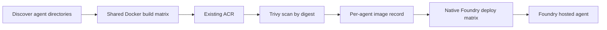

# Agent catalog

Agent source and native Microsoft Foundry deployment configuration. One GitHub
workflow discovers agent projects and calls the shared Foundry action for each.
The shared Docker workflow builds/pushes each image to the existing ACR and scans
its digest. The native Foundry action then deploys that same digest through `azd`.
There is no wrapper workflow, custom publisher, Helm, Argo or AKS dependency.

The catalog is currently empty. The retired SRE runtime, diagnostic broker and
coding workers remain archived in
[sre-agent-foundry/agent-catalog](https://github.com/sre-agent-foundry/agent-catalog).

## Add an agent

Add `agents/<name>/azure.yaml` and a Dockerfile alongside the agent source and
dependency files.
Names use lowercase letters, digits and hyphens; repository name plus agent name
must fit 63 characters. Use the directory name as the native agent service key.
New directories are discovered automatically; no workflow edit is needed.

For example, a `researcher` container project could declare:

```yaml
name: researcher

services:
  foundry:
    host: azure.ai.project
    endpoint: ${FOUNDRY_PROJECT_ENDPOINT}

  researcher:
    host: azure.ai.agent
    uses: [foundry]
    kind: hosted
    name: ${AZURE_ENV_NAME}
    project: .
    language: docker
    image: ${HOSTED_AGENT_IMAGE}
    docker:
      remoteBuild: true
    protocols:
      - protocol: responses
        version: 2.0.0
    env:
      PYTHONNOUSERSITE: "1"
```

The Dockerfile must serve the selected Foundry protocol and should use a hardened,
pinned base with locked application dependencies and appropriate application test
steps. Configure the model, resources and tools through native `azure.yaml` and
code. `HOSTED_AGENT_IMAGE` comes from the verified build record. The shared action
sets `AZD_AGENT_SKIP_ACR=true`; `docker.remoteBuild: true` makes the core package
phase a no-op, and the extension consumes the prebuilt image without an ACR build.
Do not use `codeConfiguration` on this prebuilt-container path. No custom
`deployment.json` or `smoke.json` contract is required.

## Delivery



PRs discover and build agents without publishing or Azure login. Main pushes and
manual main runs publish images, scan each immutable digest and release an
`image-<agent>` record only after success. HIGH or CRITICAL vulnerabilities fail
the build job. The push precedes scanning: a rejected image remains in ACR but is
not released to Foundry by this workflow. All builds must succeed before the
batch deploys. Application-specific tests belong in each build or an explicit
caller job; image signing is not implemented here.

Both shared blocks remain scalar. The caller owns the build/deploy matrices,
source checks and concurrency. Each deployment downloads its agent's record from
the same workflow run and verifies repository, revision, image path and digest.
It never consumes a last-writer matrix output as a digest map. Artifact overwrite
supports build reruns; rerunning only deployment can reuse the successful build
record while GitHub retains it. Missing records fail rather than falling back to
a mutable tag. Up to four agents run per stage; each agent's deployment is
serialized. A stale checkout/main revision fails before Azure login.

The native Foundry action reuses installed `azd` or installs it when missing,
ensures the extension, uses GitHub OIDC and prepares local context. Its image input
is always `registry/path@sha256:...` from the build record; no second build is
requested. Native environment names derive from repository and agent; use
`${AZURE_ENV_NAME}` as the hosted-agent name. `.azure/` directories are ignored.
An empty catalog safely skips both matrices.

Set repository variables `FOUNDRY_PROJECT_ENDPOINT` and `AZURE_LOCATION` to the
operator-provided existing project endpoint and Azure region. The existing
organization secrets `AZURE_CLIENT_ID`, `AZURE_TENANT_ID` and
`AZURE_SUBSCRIPTION_ID` provide the federated identity contract. The current platform
reuses `kubernetes-spn`; effective CI login and deployment still need live proof.
Keep credentials and private configuration out of source and images.

This workflow invokes deployment, not infrastructure provisioning. Native azd can
configure agent identity/RBAC and applies endpoint settings from `azure.yaml`;
its required permissions and image-pull access must be available. Pin the serving
version before deploying a candidate and promote explicitly. Application smoke
tests, evaluation, promotion, rollback and deletion are not automated here.
Removing a directory does not delete its hosted agent. Coordinate external writers;
GitHub concurrency is not a cloud-wide deployment lock.

With no agents, validation proves discovery, handoff checks and safe skipping.
Actual builds/scans, identity mapping, image/model access and hosted execution
remain first-agent acceptance gates. This PR does not deploy an agent, sign an
image, assert application test coverage or restore the retired image-pull role.

References: [Microsoft CI/CD guidance](https://learn.microsoft.com/en-us/azure/foundry/agents/how-to/set-up-ci-cd-cli),
[native configuration](https://learn.microsoft.com/en-us/azure/foundry/agents/concepts/azure-yaml-reference),
[Foundry lifecycle](https://learn.microsoft.com/en-us/azure/foundry/agents/how-to/manage-hosted-agent).
