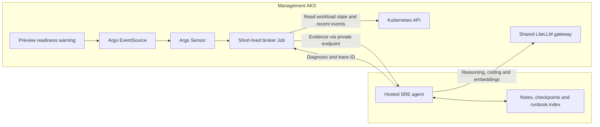

# SRE agent

The SRE agent runs as a versioned container in **Microsoft Foundry** and returns structured diagnoses through its Entra-authenticated Invocations endpoint. The `agent-catalog-sre` Argo CD application manages the **AKS monitoring integration**: the readiness EventSource, Sensor, and identities and permissions for the broker Job.

## Configuration and code

| Component | Where to look |
| --- | --- |
| Agent behaviour | [config/agent.yaml](config/agent.yaml) defines instructions, tools, model capability, request limits, response schema and memory settings. |
| Foundry hosting | [azure.yaml](azure.yaml) selects the project, image, endpoint protocol and runtime environment. [image/](image/) builds the container and pins its Python dependencies. |
| Request handling and tools | [hosting/server.py](hosting/server.py) handles Invocations. [runtime/agent.py](runtime/agent.py) wires the shared [agent runtime](https://github.com/ai-platform-portfolio/application-library/tree/main/agent-runtime) to model clients and the read-only tools in [tools/diagnostics.py](tools/diagnostics.py). |
| Model access | The `bounded-agent` policy in `config/agent.yaml` selects scoped reasoning, coding and embedding connections through the shared [LiteLLM gateway](https://github.com/ai-platform-portfolio/gitops/tree/main/helm_chart/platform/packages/litellm). Delivery resolves model aliases and Key Vault secret references. |
| Context and traces | [knowledge/](knowledge/) holds reviewed runbooks. Foundry stores caller-scoped notes and checkpoints and indexes the runbooks for retrieval. [telemetry/tracing.py](telemetry/tracing.py) configures OpenTelemetry export. |
| Monitoring | [config/diagnostics.yaml](config/diagnostics.yaml) selects the target, currently the `api` workload in `preview-environments` PR 12. [deploy/events.yaml](../../deploy/events.yaml) declares the readiness subscription and Job template. [tools/broker.py](tools/broker.py) reads the target namespace and calls the pinned Foundry version using its own workload identity. The Job logs the diagnosis and trace ID. |
| Delivery and checks | [deploy-agents.yml](../../.github/workflows/deploy-agents.yml) uses [ops-shared](https://github.com/ai-platform-portfolio/ops-shared) to build, scan and deploy the candidate. It uses the [application Helm chart](https://github.com/ai-platform-portfolio/application-helm-chart) for monitoring and access resources, runs [hosted evaluations](evaluation/), and verifies the broker before enabling the Sensor. [tests/](tests/) holds local checks. |
| Draft fixes | [config/coding.yaml](config/coding.yaml) defines coding policy. The separate [incident workflow](../../.github/workflows/incident.yml) can ask Foundry for a patch, validate it in a sandbox and publish a draft PR. Readiness monitoring records a diagnosis in the broker Job logs. |
